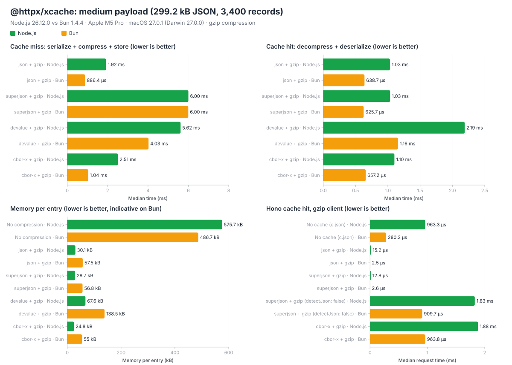

# @httpx/xcache benchmark report

Generated on 2026-10-29 with @httpx/xcache 0.13.0.

## Platform

|              |                              |
| ------------ | ---------------------------- |
| OS           | macOS 27.0.1 (Darwin 27.0.0) |
| Architecture | arm64                        |
| CPU          | Apple M5 Pro (18 cores)      |
| Memory       | 24 GiB                       |

## Engines

| Runtime | Version | JS engine                            |
| ------- | ------- | ------------------------------------ |
| Node.js | 26.13.0 | V8 14.6.202.34-node.40               |
| Bun     | 1.4.4   | JavaScriptCore (WebKit d6375c72affe) |

## Summary

Best serializer per scenario (Node.js, excluding "No compression"):

| Scenario | ⚡ Fastest miss | 🚀 Fastest hit | 🪶 Smallest memory |
| --- | --- | --- | --- |
| Small payload | json + gzip | all similar | devalue + gzip |
| Medium payload | json + gzip | cbor-x + gzip | cbor-x + gzip |
| Large payload | json + gzip | superjson + gzip | cbor-x + gzip |
| Large payload with extended types | cbor-x + gzip | cbor-x + gzip | cbor-x + gzip |

## Method

- The cached function resolves immediately: times are the cache overhead only.
- **Cache miss**: cache key generation, serialization, compression and storage (a new key each time).
- **Cache hit**: lookup, decompression and deserialization of the same key.
- Times are medians (mean, p99 and sample count in `report.json`).
- **Memory per entry**: growth of `heapUsed + external` after a forced GC, when adding fresh payloads to a cache already holding 2 entries (fixed costs excluded), median of 3 runs (5 on Bun, runs without growth ignored, "n/a" when none). It includes the entry overhead (meta, key, lru node), not only the compressed bytes. "No compression" keeps the live objects.
- Compression: `CacheCompress` with `gzip` and the default options (compressed from 16K characters and 32 KB saved), `binary` encoding.

## Scenarios

⚡ fastest cache miss (serialize + compress), 🚀 fastest cache hit (decompress + deserialize), 🪶 smallest size. "No compression" is excluded, it keeps the live objects.

### 1. Small payload

Array of small records, under the compression minimum size (stored as-is): 20 records, 1.7 kB as JSON.

| Serializer | Stored as | Compressed size | Miss Node.js | Miss Bun | Hit Node.js | Hit Bun | Memory Node.js | Memory Bun |
| --- | --- | --: | --: | --: | --: | --: | --: | --: |
| No compression | native | - | 875 ns | 584 ns | 250 ns | 208 ns | 4.1 kB | 3 kB |
| json + gzip | native | - | ⚡ **4.8 µs** | ⚡ **2.2 µs** | 🚀 **333 ns** | 🚀 **209 ns** | 4.7 kB | 5.3 kB |
| superjson + gzip | native | - | 32.3 µs | 27.4 µs | 🚀 **333 ns** | 🚀 **209 ns** | 4.7 kB | 5.4 kB |
| devalue + gzip | native | - | 19.5 µs | 10.0 µs | 🚀 **333 ns** | 🚀 **209 ns** | 🪶 **2.1 kB** | 🪶 **5.3 kB** |
| cbor-x + gzip | native | - | 7.0 µs | 4.4 µs | 🚀 **333 ns** | 🚀 **209 ns** | 4.8 kB | 5.5 kB |

### 2. Medium payload

Array of records, compressed with the default options: 3,400 records, 299.2 kB as JSON.

| Serializer | Stored as | Compressed size | Miss Node.js | Miss Bun | Hit Node.js | Hit Bun | Memory Node.js | Memory Bun |
| --- | --- | --: | --: | --: | --: | --: | --: | --: |
| No compression | native | - | 917 ns | 625 ns | 291 ns | 208 ns | 575.7 kB | 486.7 kB |
| json + gzip | compressed | 27.8 kB | ⚡ **1.91 ms** | ⚡ **902.6 µs** | 1.13 ms | 665.6 µs | 30.1 kB | 56.9 kB |
| superjson + gzip | compressed | 27.8 kB | 6.56 ms | 6.12 ms | 1.12 ms | 🚀 **620.2 µs** | 28.8 kB | 57.1 kB |
| devalue + gzip | compressed | 66.8 kB | 6.04 ms | 3.97 ms | 2.27 ms | 1.16 ms | 67.6 kB | 138.6 kB |
| cbor-x + gzip | compressed | 🪶 **22.9 kB** | 2.46 ms | 1.03 ms | 🚀 **1.11 ms** | 638.2 µs | 🪶 **24.9 kB** | 🪶 **55 kB** |

### 3. Large payload

Array of records, compressed with the default options: 44,000 records, 3.9 MB as JSON.

| Serializer | Stored as | Compressed size | Miss Node.js | Miss Bun | Hit Node.js | Hit Bun | Memory Node.js | Memory Bun |
| --- | --- | --: | --: | --: | --: | --: | --: | --: |
| No compression | native | - | 917 ns | 666 ns | 291 ns | 208 ns | 8.4 MB | 6.4 MB |
| json + gzip | compressed | 360.1 kB | ⚡ **23.4 ms** | ⚡ **11.8 ms** | 13.7 ms | 9.33 ms | 360.9 kB | 721.5 kB |
| superjson + gzip | compressed | 360.1 kB | 92.0 ms | 75.1 ms | 🚀 **13.0 ms** | 10.8 ms | 359.9 kB | 721.5 kB |
| devalue + gzip | compressed | 848.6 kB | 106 ms | 78.2 ms | 30.8 ms | 18.3 ms | 848 kB | 1.7 MB |
| cbor-x + gzip | compressed | 🪶 **297.3 kB** | 30.7 ms | 13.2 ms | 13.3 ms | 🚀 **8.50 ms** | 🪶 **308.1 kB** | 🪶 **702.4 kB** |

### 4. Large payload with extended types

Same as large, with Date, BigInt, undefined and NaN values (json is not supported): 44,000 records, 6.9 MB as JSON.

| Serializer | Stored as | Compressed size | Miss Node.js | Miss Bun | Hit Node.js | Hit Bun | Memory Node.js | Memory Bun |
| --- | --- | --: | --: | --: | --: | --: | --: | --: |
| No compression | native | - | 1.1 µs | 625 ns | 292 ns | 208 ns | 16.1 MB | 11.3 MB |
| superjson + gzip | compressed | 1.2 MB | 593 ms | 351 ms | 241 ms | 155 ms | 1.2 MB | 2.4 MB |
| devalue + gzip | compressed | 1.4 MB | 211 ms | 134 ms | 71.4 ms | 48.9 ms | 1.4 MB | 2.9 MB |
| cbor-x + gzip | compressed | 🪶 **588.9 kB** | ⚡ **59.0 ms** | ⚡ **31.5 ms** | 🚀 **21.6 ms** | 🚀 **12.2 ms** | 🪶 **601.5 kB** | 🪶 **1.2 MB** |

## Hono (medium payload)

`createHonoXCache` with a JSON response (`JsonSerializer`) and an `XMemCache` instance compressing with different serializers, 299.2 kB as JSON, response body read by the client. Compressed entries are sent as-is (`Content-Encoding: gzip`) when their bytes are JSON: `JsonSerializer`, or superjson with JSON detection (`detectJson`, default) when the data has no extended types. Otherwise they are decompressed, deserialized and serialized to JSON on each request.

| Setup | Hit sent as-is | Miss Node.js | Miss Bun | Hit gzip Node.js | Hit gzip Bun | Hit identity Node.js | Hit identity Bun |
| --- | --- | --: | --: | --: | --: | --: | --: |
| No cache (c.json) | - | 992.3 µs | 289.1 µs | 930.9 µs | 285.3 µs | 926.9 µs | 283.6 µs |
| json + gzip | ✅ yes | ⚡ **1.93 ms** | ⚡ **888.3 µs** | 15.2 µs | 🚀 **2.6 µs** | 644.9 µs | 🚀 **293.9 µs** |
| superjson + gzip | ✅ yes | 6.13 ms | 4.80 ms | 🚀 **11.8 µs** | 2.7 µs | 🚀 **627.2 µs** | 294.2 µs |
| superjson + gzip (detectJson: false) | ❌ no | 8.02 ms | 6.10 ms | 1.78 ms | 920.5 µs | 1.79 ms | 907.0 µs |
| cbor-x + gzip | ❌ no | 4.62 ms | 2.72 ms | 1.88 ms | 1.01 ms | 1.84 ms | 964.1 µs |

- **No cache (c.json)**: Hono c.json(payload) on each request, baseline (the payload is already in memory, a real handler also pays the data fetching).
- **json + gzip**: Compressed JSON, sent as-is.
- **superjson + gzip**: Plain data detected and stored as JSON (detectJson), sent as-is.
- **superjson + gzip (detectJson: false)**: Stored in the superjson format: decompressed, deserialized and serialized to JSON.
- **cbor-x + gzip**: Stored as CBOR: decompressed, deserialized and serialized to JSON.

"Hit gzip": client accepting gzip (`Accept-Encoding: gzip`), "Hit identity": client not accepting it (the compressed bytes are decompressed). "No cache" is the baseline (same time for miss and hits), not a candidate for the icons.

## Bun vs Node.js

Bun 1.4.4 vs Node.js 26.13.0 (geometric mean of the median times of all serializers, memory is indicative: each engine accounts memory differently).

| Scenario | Cache miss | Cache hit | Memory per entry |
| --- | --: | --: | --: |
| Small payload | **1.65× faster** | **1.51× faster** | 1.21× more |
| Medium payload | **1.65× faster** | **1.71× faster** | 1.70× more |
| Large payload | **1.60× faster** | **1.46× faster** | 1.70× more |
| Large payload with extended types | **1.71× faster** | **1.54× faster** | 1.56× more |
| Hono, medium payload (requests) | **1.84× faster** | **2.65× faster** | - |
| **Overall** (cache) | **1.65× faster** | **1.55× faster** | 1.53× more |
